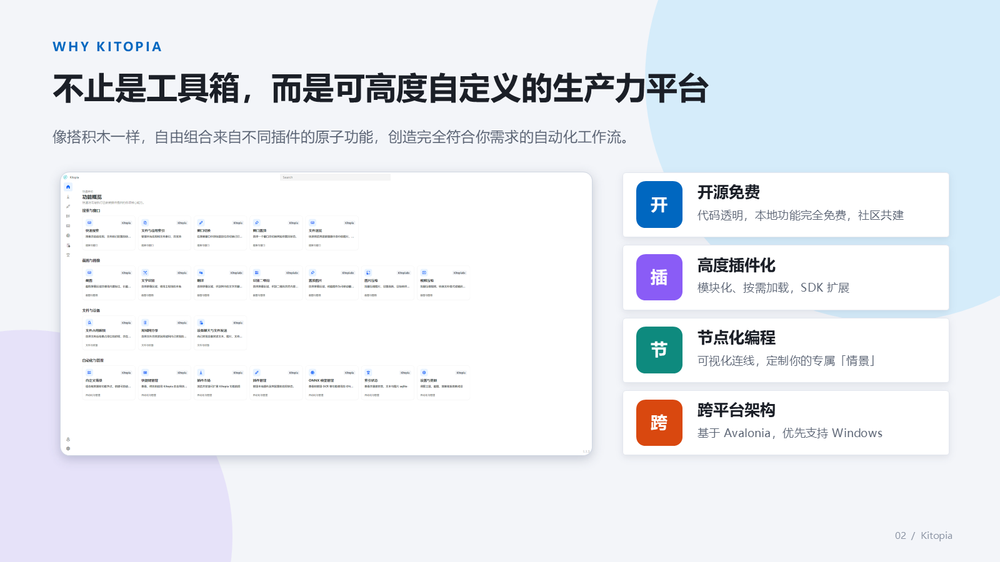
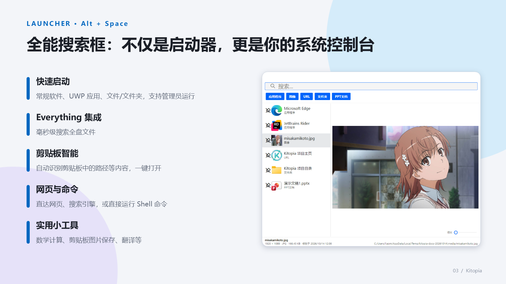
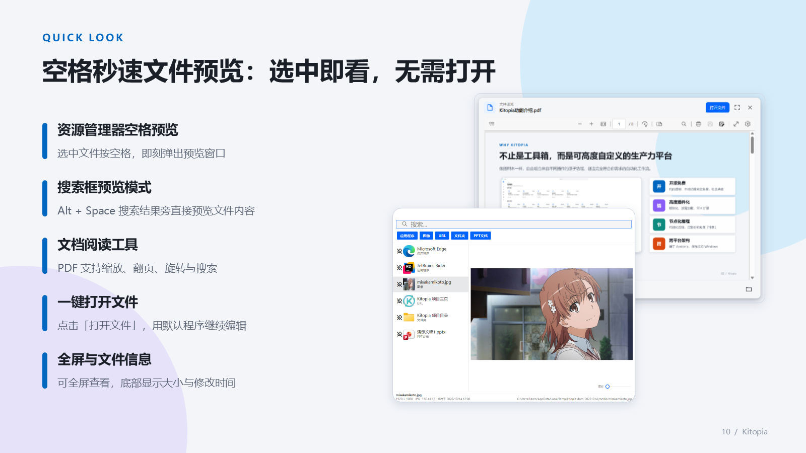
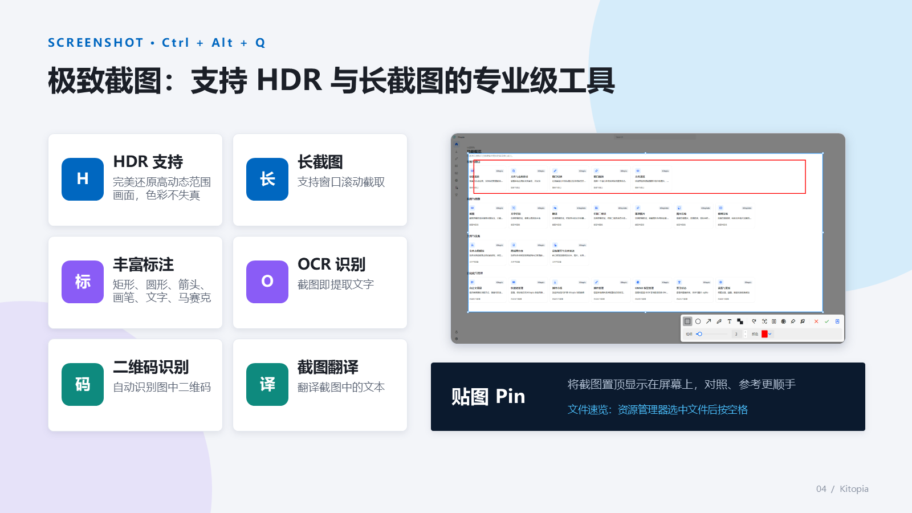
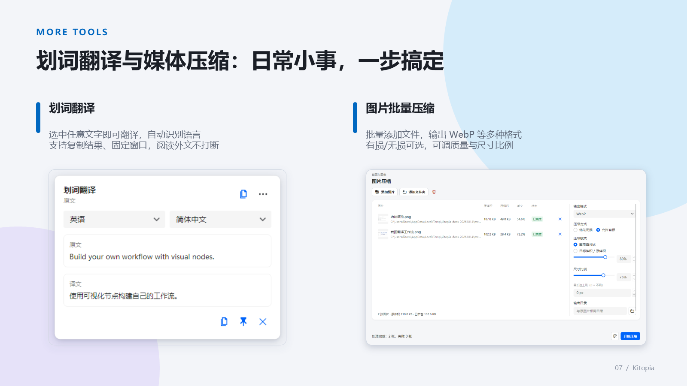
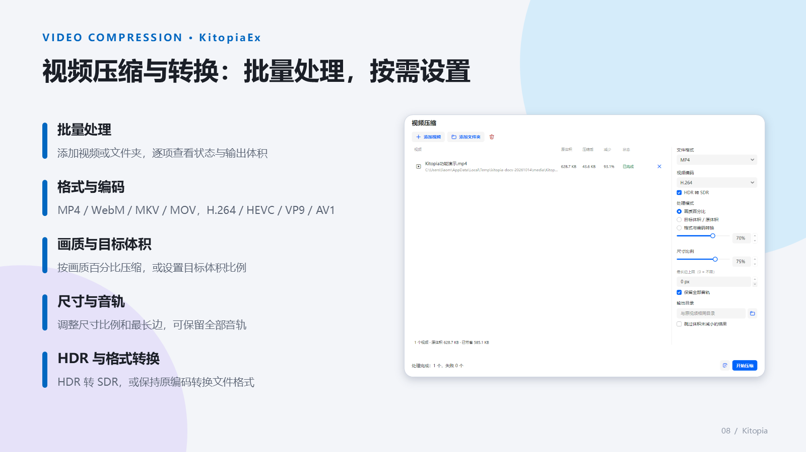
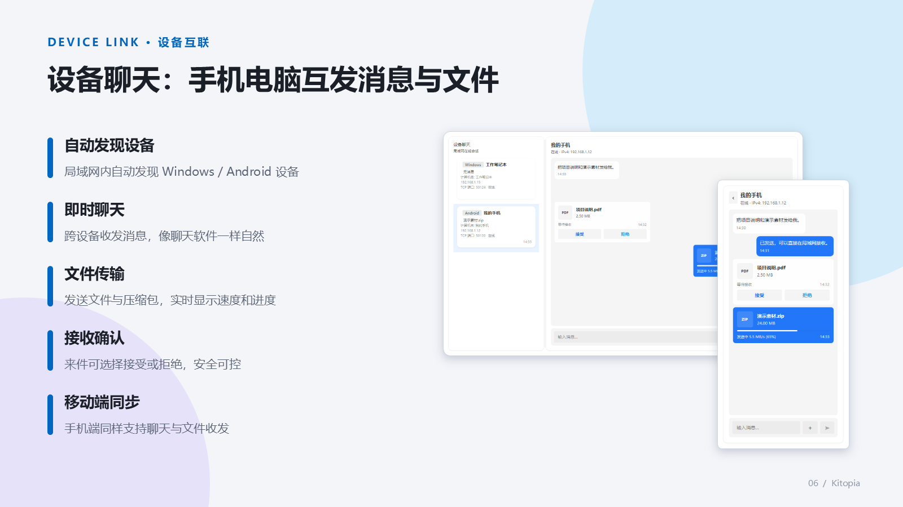
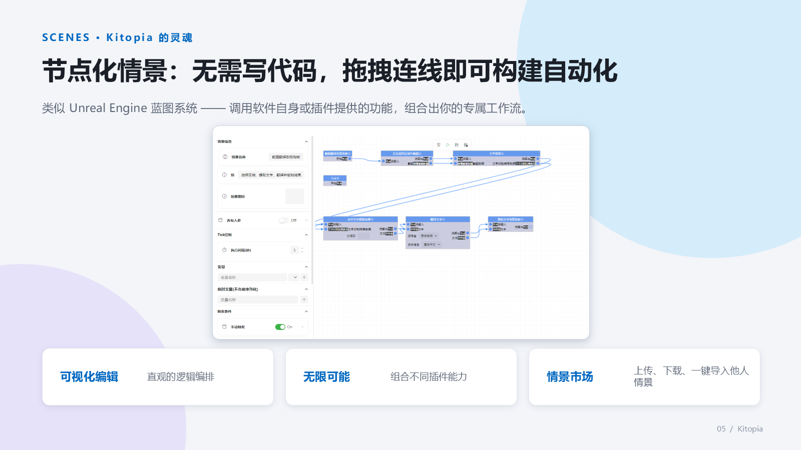
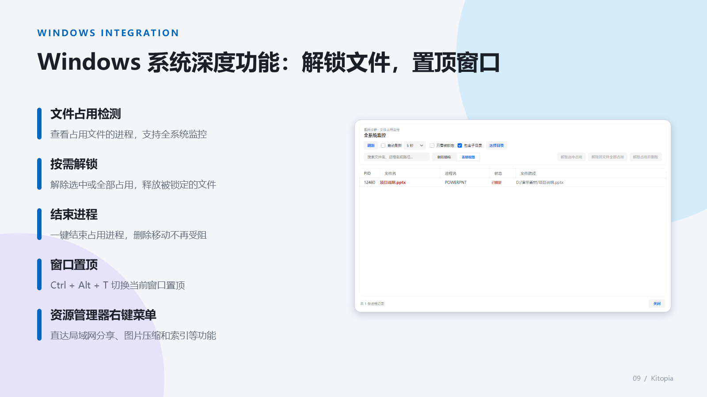

# Kitopia - 属于你的新一代桌面全能效率神器

[](https://deepwiki.com/Maklith/Kitopia)
> [English](/docs/en-us/README.md)

[](https://github.com/Maklith/Kitopia)
[](https://github.com/Maklith/Kitopia/releases)


> **开源 · 现代 · 插件化 · 节点化**  
> 集成搜索与启动、本地 AI 语义搜索、文件速览、截图与 OCR、跨设备互传、媒体压缩和可视化工作流的桌面工具。

---

## ✨ 功能概览



---

## ⌨️ 常用快捷键（开箱即用）

安装后即可直接体验的经典快捷键：

| 功能 | 默认快捷键 / 触发方式 | 日常使用场景 |
| :--- | :--- | :--- |
| **唤出 / 隐藏搜索框** | `Alt + Space` | 随时打开应用、搜文件、算数学题、查汇率与启动工具 |
| **全能屏幕截图** | `Ctrl + Alt + Q` | 区域截图、长截图、画笔标注、取色与离线提取文字 |
| **文件秒速预览** | 资源管理器中选中文件按 `Space` | 空格秒开查看 PDF、图片、代码、Markdown 与压缩包 |
| **划词翻译** | `Ctrl + Alt + Y` 或 鼠标划选文本后释放 | 浏览外文网页、读文档时即划即翻，无缝阅读 |
| **窗口固定置顶** | `Ctrl + Alt + T` | 边看参考资料边写代码/文档，窗口始终浮在最上层 |

> 💡 *所有快捷键均可在设置中自由修改，支持键盘按键、鼠标按键（如侧键）以及按进程设置生效范围。*

---

## 🎯 场景化功能图解

### 1. 全能搜索与全局启动中心



`Alt + Space` 唤出搜索框，启动应用、打开文件或文件夹，也可识别剪贴板路径、访问网页和运行 Shell 命令。支持列表模式与分栏预览、拼音匹配、历史收藏与置顶。Everything 提供全盘文件检索；本地 AI 可按文档内容或图片描述查找文件，需要配置模型和推理后端。

图片素材：[《某科学的超电磁炮 T》御坂美琴角色页面](https://toaru-project.com/railgun_t/chara/mikoto.html)。

---

### 2. 空格秒速文件预览（Quick Look）



在 Windows 资源管理器中选中文件后按 `Space`，或在搜索框中切换预览模式，即可查看文件内容。PDF 支持缩放、翻页、旋转与搜索；可全屏查看，底部显示文件大小与修改时间，点击“打开文件”可用默认程序继续操作。也支持图片、文本、代码和压缩包。PDF 预览需要 WebView2 Runtime。

---

### 3. 全能截图、专业标注与离线 OCR



`Ctrl + Alt + Q` 开始截图，支持 HDR、长截图、标注与取色。OCR 使用本地模型；二维码识别、贴图与截图翻译由 `KitopiaEx` 提供，翻译需要网络服务。

---

### 4. 悬浮划词翻译与图片 / 视频批量压缩



划词后按 `Ctrl + Alt + Y`，或开启鼠标划选自动翻译。`KitopiaEx` 支持批量压缩 JPG、PNG、WebP，按画质或目标体积处理，并调整图片尺寸。



视频支持 MP4、WebM、MKV、MOV，以及 H.264、HEVC、VP9、AV1，编码选项随格式变化。可设置目标体积、尺寸比例、最长边、音轨保留和 HDR 转 SDR，也可保持原编码转换文件格式。

---

### 5. 跨设备局域网极速互传（Kitopia Mobile）



Windows 与 Android 设备可在局域网中自动发现，免登录收发消息和文件。传输采用 TCP/TLS，支持接收确认、进度和速度显示。

---

### 6. 节点化情景自动化（像搭积木一样定制工作流）



连接截图、OCR、翻译和剪贴板等节点，构建自己的工作流。情景可通过搜索、快捷键或配置的触发器运行，也可从情景市场下载导入。

---

### 7. Windows 系统深度贴心赋能



查看占用文件的进程，按需解锁或结束进程；`Ctrl + Alt + T` 切换窗口置顶。资源管理器右键菜单可进入局域网分享、图片压缩和索引等常用功能。

---

### 8. 插件生态与硬件加速


在插件中心安装、启用和管理扩展。OCR 与语义搜索使用本地 ONNX 模型，可选择 CPU、Windows GPU 或 Intel OpenVINO 后端，具体设备支持取决于插件和运行环境。

---

## 📥 下载与安装

请前往 [GitHub Releases 发布页面](https://github.com/Maklith/Kitopia/releases) 下载最新安装包：

| 平台 / 端 | 版本类型 | 说明 |
| :--- | :--- | :--- |
| **Windows 桌面端 (推荐)** | `win-x64` / `win-arm64` 安装包 (.exe) | 推荐普通用户使用，一键安装并自动创建快捷方式与右键菜单组件 |
| **Windows 便携版** | `win-x64` / `win-arm64` 绿色压缩包 (.zip) | 解压即用，配置随应用走，适合放在 U 盘或移动硬盘随身携带 |
| **Android 移动端** | `android-arm64` / `android-x64` APK | 手机端极速互传助手，最低支持 Android 6.0，与电脑同 Wi-Fi 即可互通 |
| **Linux / iOS** | 平台适配中 | Linux 桌面端已具备基础运行能力；iOS 移动端项目在持续推进中 |

> 📌 **使用提示**：
> 1. **全盘文件搜索**：建议配合已安装并运行的 Everything 使用（可在 Kitopia 设置中开启跟随启动，体验全盘毫秒级响应）。
> 2. **高级扩展功能**：截图二维码识别、截图翻译、贴图与批量图片 / 视频压缩等特性由官方扩展插件 `KitopiaEx` 提供，可在“已安装插件”中确认启用。
> 3. **本地 AI 与 OCR**：首次使用本地语义检索和离线 OCR 时，系统会自动准备好轻量模型，无需手动配置复杂的 Python 或 AI 环境。

---

## 🔒 隐私与数据安全

在数据与隐私至关重要的今天，Kitopia 坚持**本地优先（Local-First）**原则：

- 🛡️ **数据全本地化**：你的文件索引、搜索记录、OCR 识别文字与 AI 向量数据全部存放在你本地的电脑中（默认位于 `%LOCALAPPDATA%\Kitopia`），绝不上传到任何开发者服务器。
- 🛡️ **点对点无痕传输**：跨设备局域网互传采用端到端 TLS 加密传输，免登录、不经过任何第三方云中转，断网/离线内网也能照常传输。
- 🛡️ **开源透明无广告**：代码完全公开，没有任何形式的弹窗广告、全家桶捆绑或后台静默行为。

---

## ❓ 常见问题 (FAQ)

<details>
<summary><b>Q1: 为什么全盘搜索某些文件搜不到？</b></summary>

Kitopia 的全盘文件检索深度依赖 Everything。请确保系统已安装 Everything 并正在运行。在搜索框内输入 `@` 加上关键词（例如 `@报告`）即可调用 Everything 搜索。如果希望不用输 `@` 直接搜索所有文件，可以在 Kitopia 设置的「文件索引」中开启相应选项。
</details>

<details>
<summary><b>Q2: 本地 AI 语义搜索和 OCR 会占用很高的 CPU/显卡吗？</b></summary>

不会。内置的 AI 模型经过极致轻量化量化处理，平时待机占用为 0。仅在建立索引和触发文字识别的瞬间执行计算。此外，你可以在设置中灵活限制索引任务的 CPU 占用上限，或者切换使用 GPU/OpenVINO 加速，工作和游戏完全不受影响。
</details>

<details>
<summary><b>Q3: 手机和电脑无法自动发现彼此怎么办？</b></summary>

1. 请确保手机与电脑连接的是**同一个 Wi-Fi 网络**（不要一个连 5G Wi-Fi 访客网络，另一个连内网）。
2. 检查路由器后台是否开启了“AP 隔离（无线隔离 / Client Isolation）”，如果开启请关闭。
3. 检查电脑端的 Windows 防火墙，确保已允许 Kitopia 在局域网中通信。
</details>

<details>
<summary><b>Q4: 快捷键和游戏/其他软件冲突了怎么办？</b></summary>

点击 Kitopia 主界面左侧导航栏的键盘图标进入「快捷键管理」，即可双击任意操作自定义快捷键。你可以将其改成不常用的组合键、鼠标侧键，或者设置“仅在某些程序中生效/排除特定游戏程序”。
</details>

---

## 🤝 开源与社区

Kitopia 是一个自由、开源的项目，遵循 **GPL-3.0** 开源协议。如果你喜欢这个项目，欢迎前往 GitHub 为它点一颗 ⭐️ Star 支持作者！

- 🌐 [项目主页 (GitHub)](https://github.com/Maklith/Kitopia)
- 🐛 [问题反馈与功能建议 (Issues)](https://github.com/Maklith/Kitopia/issues)
- 🔌 [插件开发 SDK (PluginCore)](https://github.com/Maklith/PluginCore)
- 📜 [开源许可证 (GPL-3.0)](https://github.com/Maklith/Kitopia/blob/HEAD/LICENSE)

<details>
<summary><b>💻 开发者构建指引（极客与贡献者点击展开）</b></summary>

项目核心技术栈采用 **.NET 10 / C#**、**Avalonia UI** 与 **Rust**（安装器）：

```powershell
# 克隆仓库并拉取子模块
git clone --recurse-submodules https://github.com/Maklith/Kitopia.git
cd Kitopia

# 编译桌面端
dotnet restore "src/Kitopia.Desktop/Kitopia.Desktop.csproj"
dotnet build "src/Kitopia.Desktop/Kitopia.Desktop.csproj" -c Debug

# 运行单元测试
dotnet test "tests/KitopiaTest/KitopiaTest.csproj"
```

更多开发架构规范与依赖边界请参阅仓库根目录下的 `AGENTS.md`。
</details>
