# Kitopia - 属于你的新一代桌面全能效率神器

[](https://deepwiki.com/Maklith/Kitopia)
> [English](/en-us/)

[](https://github.com/Maklith/Kitopia)
[](https://github.com/Maklith/Kitopia/releases)


> **开源 · 现代 · 插件化 · 节点化**  
> 一站式集成全局极速启动、本地 AI 语义搜索、空格文件速览、全能截图、离线 OCR、跨设备无线互传与工作流自动化。

---

## 💡 为什么需要 Kitopia？

在日常使用电脑时，你是否遇到过这些烦恼：

- 想空格预览文件，得安装 QuickLook；
- 想截图标注，得开 Snipaste；想划词翻译，得开浏览器插件或翻译软件；
- 手机和电脑传个文件或文字，还得登录微信把内容发给“文件传输助手”……
- 桌面和后台常驻了一堆小工具，快捷键经常互相冲突，内存越占越多。

**Kitopia 就是为了彻底终结这种繁琐与割裂而生。**

Kitopia 以一个极简优雅的搜索框与现代化的 Fluent 界面为入口，将**全盘毫秒级搜索、空格文件秒速预览、专业级截图标注、离线文字识别、划词即翻、多设备局域网飞传、图片/视频压缩**以及**像搭积木一样的自动化工作流**合而为一。

无需频繁切换应用，无需繁杂配置，随时随地一个快捷键，即刻搞定所有高频操作。

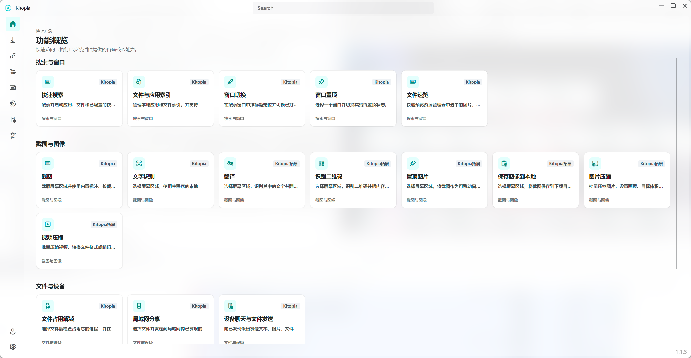

---

## ✨ 核心亮点

- 🚀 **极速搜索与全局启动**：毫秒级启动软件、打开文件与执行系统命令；支持全拼/简拼模糊匹配与历史收藏置顶。
- 🧠 **本地 AI 语义搜索**：不记得文件名？直接搜索文档内文语句（支持 Word/Excel/PPT/PDF/Markdown），甚至可以通过自然语言描述在本地图库中“以文搜图”！
- 👁️ **空格键秒速预览（Quick Look）**：在文件资源管理器中选中任意文件，轻敲空格键即可直接预览 PDF、代码、Markdown、图片和压缩包，无需等待大型软件启动。
- 📸 **全能截图标注 & 离线 OCR**：原生 HDR 画质支持、平滑滚动长截图、丰富画笔标注与取色器；内置本地 OCR 模型，离线提取图中文字、一键识别二维码、贴图置顶与截图翻译。
- 🌐 **无感划词翻译**：鼠标选中文字即刻弹出优雅的翻译浮窗，支持多国语言互译与按需排除指定应用。
- 📲 **跨设备局域网极速互传**：电脑与手机在同一 Wi-Fi 下自动发现，无需数据线、无需登录账号，文字、照片、无损大文件秒传，点对点加密直达。
- 🪄 **蓝图式节点自动化（情景）**：无需编写代码，通过连线即可将截图、OCR、翻译、剪贴板、键盘操作等串联成你的专属工作流，更可在情景市场一键导入现成神器。
- ⚡ **Windows 深度贴心增强**：右键菜单快捷集成、顽固“文件占用强行解锁”、窗口快捷置顶等日常高频救急功能。
- 🔒 **纯净安全，隐私优先**：AI 语义检索与 OCR 识别全部在本地硬件执行，文件绝不上传云端；开源透明，无任何弹窗广告与捆绑。

---

## ⌨️ 常用快捷键（开箱即用）

安装后即可直接体验的经典快捷键：

| 功能 | 默认快捷键 / 触发方式 | 日常使用场景 |
| :--- | :--- | :--- |
| **唤出 / 隐藏搜索框** | `Alt + Space` | 随时打开应用、搜文件、算数学题、查汇率与启动工具 |
| **全能屏幕截图** | `Ctrl + Alt + Q` | 区域截图、长截图、画笔标注、取色与离线提取文字 |
| **文件秒速预览** | 资源管理器中选中文件按 `Space` | 空格秒开查看 PDF、图片、代码、Markdown 与压缩包 |
| **划词翻译** | `Ctrl + Alt + Y` 或 鼠标划选文本后释放 | 浏览外文网页、读文档时即划即翻，无缝阅读 |
| **窗口固定置顶** | `Ctrl + Alt + T` | 边看参考资料边写代码/文档，窗口始终浮在最上层 |

> 💡 *所有快捷键均可在设置中自由修改，支持键盘按键、鼠标按键（如侧键）以及按进程设置生效范围。*

---

## 🎯 场景化功能图解

### 1. 全能搜索与全局启动中心
按下 `Alt + Space`，一切尽在眼前。
- **全能启动**：毫秒级启动常规桌面应用、Windows UWP 应用、控制面板设置项与自定义工作流。
- **拼音首字母匹配**：输入 `wx` 即搜微信，输入 `jsq` 即搜计算器，支持智能记忆常用频次。
- **Everything 闪电搜全盘**：支持通过前缀（默认 `@`）或直接输入全盘检索，百万文件毫秒呈现。
- **本地 AI 语义“以文搜文” & “以文搜图”**：
  - 记不清文件名？输入文档里的核心内容，甚至一段大概意思，AI 即可帮你找出对应的 DOCX、XLSX、PPTX、PDF 和 Markdown 文件。
  - 想找某张照片？输入“穿西装的人”、“发票报销”、“蓝天草地”，AI 即可直接定位本地匹配图片。
- **智能计算与输入识别**：输入数学算式直接出答案，输入文件路径、网址一键直达，支持读取剪贴板内容直接操作。

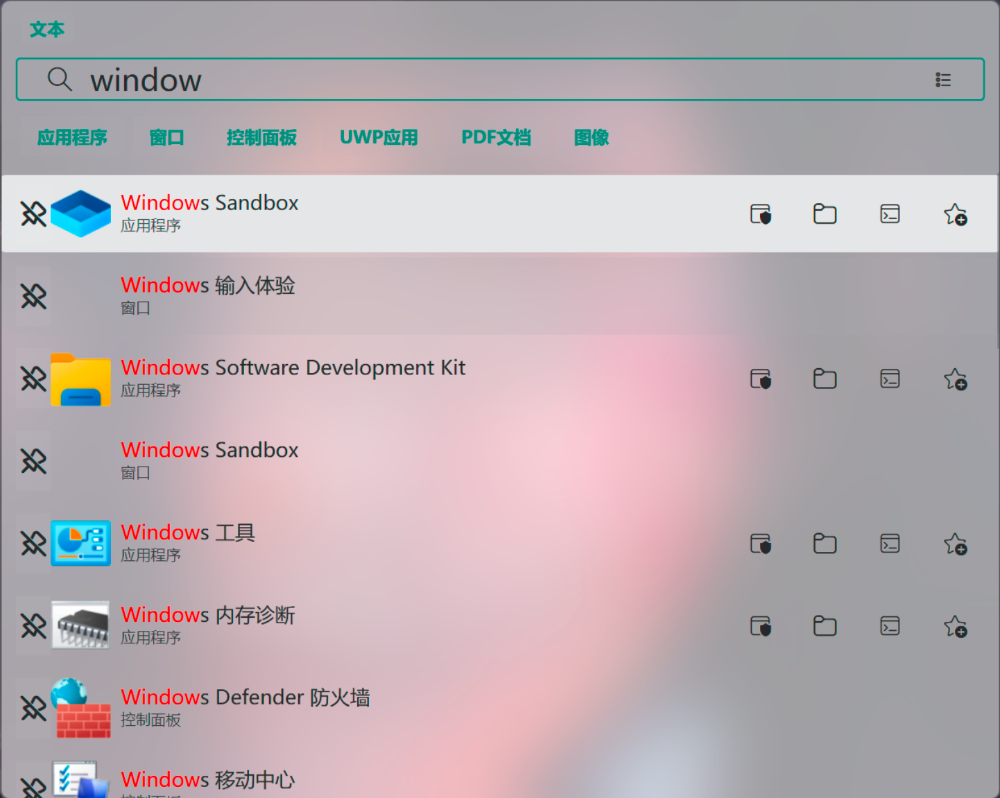

---

### 2. 空格秒速文件预览（Quick Look）
再也不用为了看一眼文件内容而苦等几秒打开 Office 或大型 IDE。
- **资源管理器一键空格预览**：在 Windows 资源管理器中选中文件，轻轻一敲空格，立刻浮现完整预览窗口。
- **丰富的预览格式**：开箱支持 PDF 多页阅读、Markdown 渲染、高清图片自由缩放、各种代码语法高亮及 ZIP 压缩包目录树浏览。
- **搜索内联动预览**：在 Kitopia 搜索结果列表中切换项目，右侧即时分栏展现对应文件内容，找文件不再“盲人摸象”。

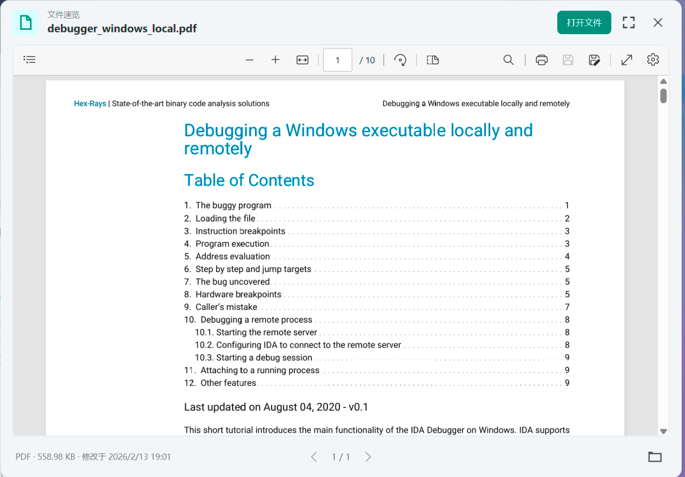
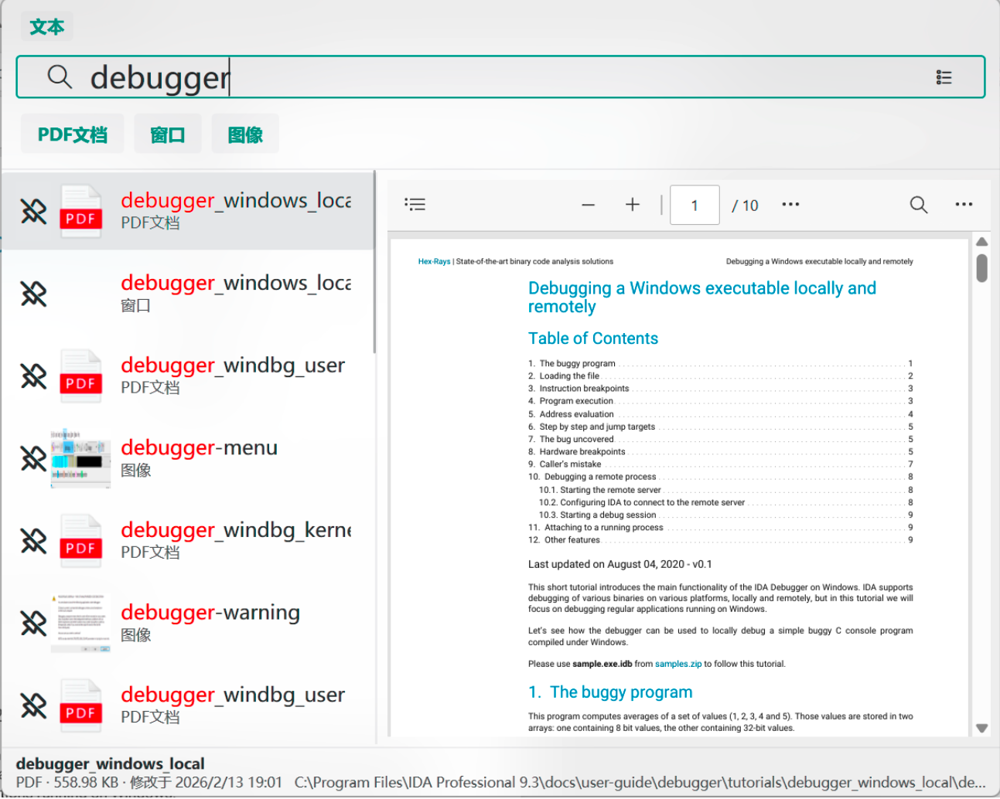

---

### 3. 全能截图、专业标注与离线 OCR
集截图、长截图、取色、贴图、文字识别于一身的生产力瑞士军刀。
- **全场景捕获**：支持自由矩形截取、智能窗口捕捉、多显示器自适应，更支持 **HDR 屏幕色彩还原**，截图不发灰、不过曝。
- **平滑滚动长截图**：向下滚动页面即可轻松拼接超长网页、聊天记录与长文档。
- **专业标注工具**：矩形、椭圆、箭头、自由画笔、荧光笔、文字说明、马赛克与高斯模糊，支持多级撤销/重做。
- **离线 OCR 文字识别**：截图后一键提取图中文字，排版还原度高，本地毫秒级识别，断网也能用，隐私不泄露。
- **贴图与二维码识别**：一键将截图“钉”在屏幕上作为浮动备忘，自动识别图中二维码并复制解析链接，支持直接对截图进行翻译。

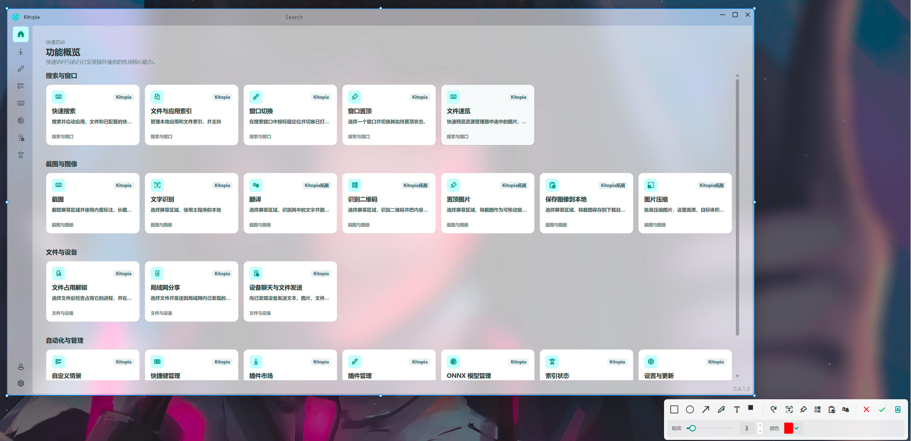

---

### 4. 悬浮划词翻译与图片批量压缩
- **流畅无感的划词翻译**：选中文本轻按快捷键，或者开启“鼠标划词松开自动触发”，悬浮窗立刻展示多语言翻译结果；支持钉住悬浮窗与快捷复制。
- **批量图片/视频压缩（KitopiaEx 扩展）**：
  - 针对办公、投稿、图床需求，支持批量压缩 JPG、PNG、WebP，支持按画质比率或目标体积压缩，支持无损压缩与尺寸缩放。
  - 支持多格式视频批量转码与体积压缩。

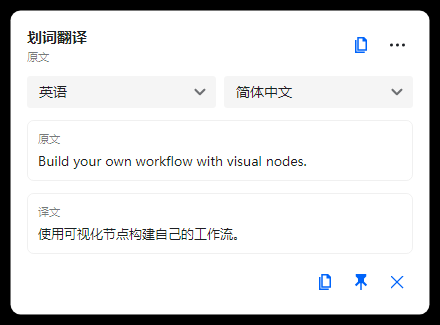
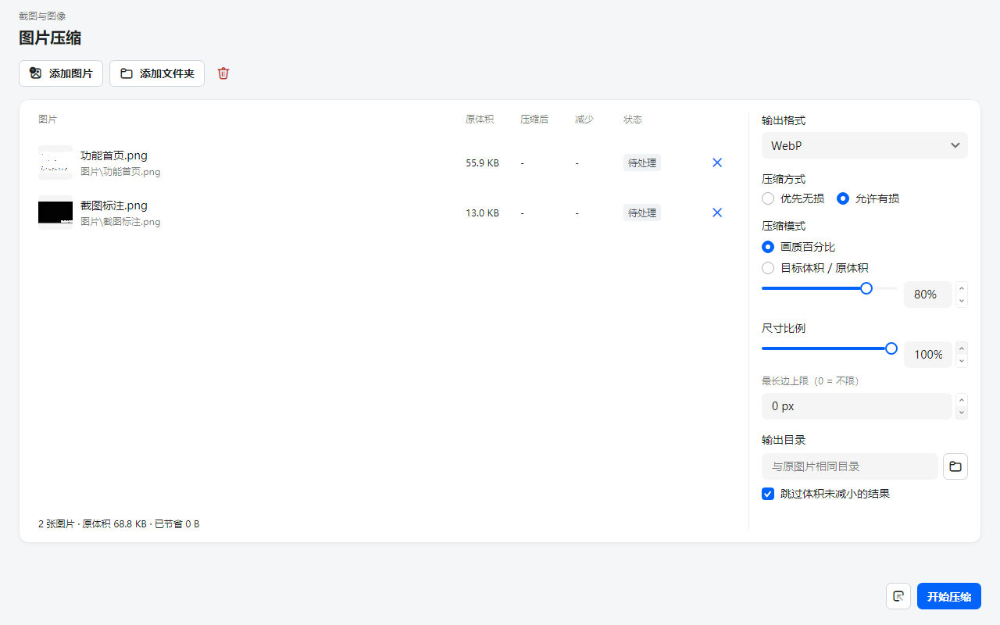

---

### 5. 跨设备局域网极速互传（Kitopia Mobile）
告别给“文件传输助手”发送私密文件的时代，摆脱数据线与云盘限速。
- **零配置自动发现**：只要手机和电脑连接在同一个 Wi-Fi 网络下，打开软件即可在几秒内自动发现对方。
- **免登录、点对点加密直传**：不需要注册任何账号，不经过任何第三方公网服务器，文字、图片、高清原图、大体积安装包即拖即传。
- **配套 Android 客户端**：提供轻巧流畅的 Android 手机客户端（Kitopia Mobile），支持后台保活、文件接收保存与系统通知提醒。

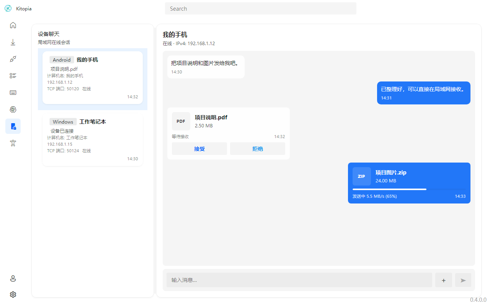

---

### 6. 节点化情景自动化（像搭积木一样定制工作流）
**Kitopia 的灵魂功能**：让每个人都能轻松打造适合自己的超级自动化工具。
- **可视化蓝图编辑**：无需代码基础，在直观的画布上拖拽节点、连接流程线，把多个功能串联起来。
- **丰富的原子能力**：内置与插件提供截图、OCR 识别、二维码解析、多语言翻译、剪贴板读写、应用启动、键盘鼠标模拟、条件判断与循环等节点。
- **随心触发**：设置好的情景既可以绑定快捷键运行，也可以直接在全局搜索框输入名称回车执行，或设置为定时自动运行。
- **情景市场**：浏览官方与社区用户分享的实用情景，一键下载导入，即刻拥有大神同款工作流。

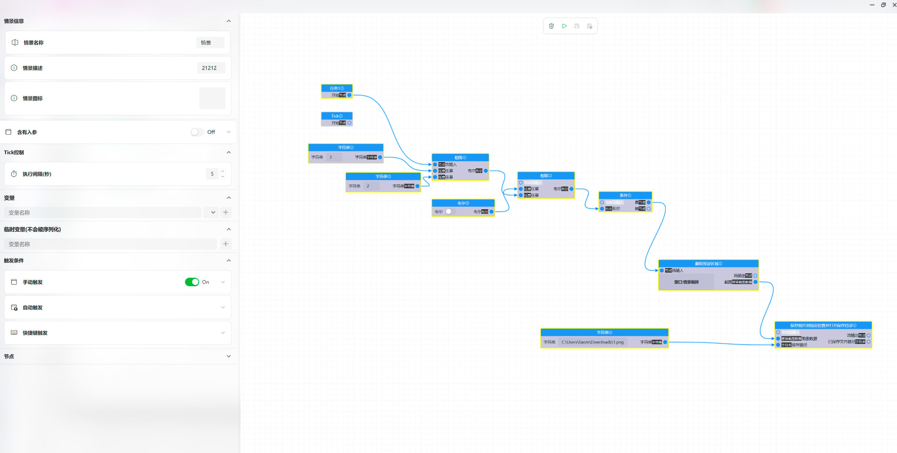

---

### 7. Windows 系统深度贴心赋能
专为 Windows 用户日常痛点量身打造：
- **文件占用解锁器**：删除或重命名文件时总提示“文件已被其他程序占用”？右键一键查看是哪个进程在占用，直接解锁或结束进程。
- **窗口置顶神器**：对准任何软件窗口按下 `Ctrl + Alt + T`，即可将其始终固定在最前，对照参考、看网课做笔记轻松惬意。
- **资源管理器右键深度集成**：右键任意文件直接调出“局域网分享”、“图片压缩”、“添加到索引”，操作丝滑流畅。

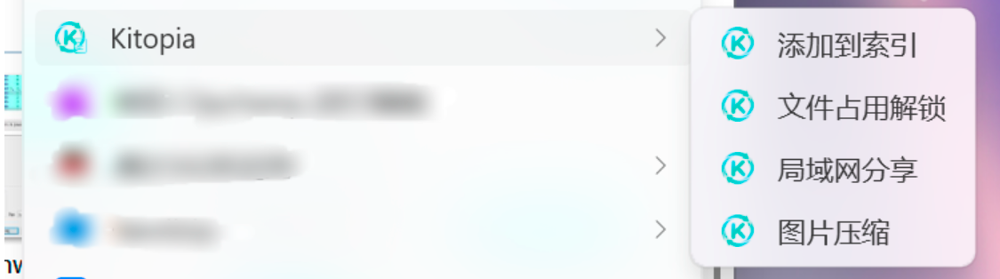

---

### 8. 插件生态与硬件加速
- **插件市场一键装卸**：功能按需加载，保持软件轻量快速。从插件市场一键安装各类扩展插件与主题。
- **硬件级本地推理加速**：支持根据你的电脑硬件灵活选择 CPU、Windows GPU (DirectML/CUDA) 或 Intel OpenVINO 硬件加速后端，充分释放轻薄本或独显主机的澎湃算力。

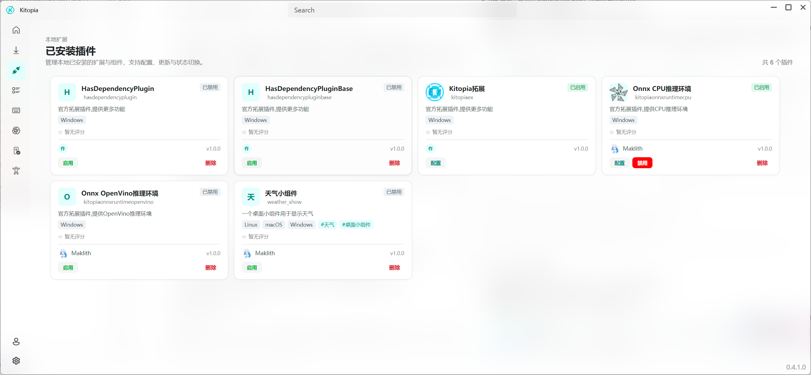

---

## 📥 下载与安装

请前往 [GitHub Releases 发布页面](https://github.com/Maklith/Kitopia/releases) 下载最新安装包：

| 平台 / 端 | 版本类型 | 说明 |
| :--- | :--- | :--- |
| **Windows 桌面端 (推荐)** | `win-x64` / `win-arm64` 安装包 (.exe) | 推荐普通用户使用，一键安装并自动创建快捷方式与右键菜单组件 |
| **Windows 便携版** | `win-x64` / `win-arm64` 绿色压缩包 (.zip) | 解压即用，配置随应用走，适合放在 U 盘或移动硬盘随身携带 |
| **Android 移动端** | `android-arm64` / `android-x64` APK | 手机端极速互传助手，最低支持 Android 6.0，与电脑同 Wi-Fi 即可互通 |
| **Linux / iOS** | 平台适配中 | Linux 桌面端已具备基础运行能力；iOS 移动端项目在持续推进中 |

> 📌 **使用提示**：
> 1. **全盘文件搜索**：建议配合已安装并运行的 Everything 使用（可在 Kitopia 设置中开启跟随启动，体验全盘毫秒级响应）。
> 2. **高级扩展功能**：截图二维码识别、截图翻译、贴图与批量图片压缩等特性由官方扩展插件 `KitopiaEx` 提供，可在“已安装插件”中确认启用。
> 3. **本地 AI 与 OCR**：首次使用本地语义检索和离线 OCR 时，系统会自动准备好轻量模型，无需手动配置复杂的 Python 或 AI 环境。

---

## 🔒 隐私与数据安全

在数据与隐私至关重要的今天，Kitopia 坚持**本地优先（Local-First）**原则：

- 🛡️ **数据全本地化**：你的文件索引、搜索记录、OCR 识别文字与 AI 向量数据全部存放在你本地的电脑中（默认位于 `%LOCALAPPDATA%\Kitopia`），绝不上传到任何开发者服务器。
- 🛡️ **点对点无痕传输**：跨设备局域网互传采用端到端 TLS 加密传输，免登录、不经过任何第三方云中转，断网/离线内网也能照常传输。
- 🛡️ **开源透明无广告**：代码完全公开，没有任何形式的弹窗广告、全家桶捆绑或后台静默行为。

---

## ❓ 常见问题 (FAQ)

<details>
<summary><b>Q1: 为什么全盘搜索某些文件搜不到？</b></summary>

Kitopia 的全盘文件检索深度依赖 Everything。请确保系统已安装 Everything 并正在运行。在搜索框内输入 `@` 加上关键词（例如 `@报告`）即可调用 Everything 搜索。如果希望不用输 `@` 直接搜索所有文件，可以在 Kitopia 设置的「文件索引」中开启相应选项。
</details>

<details>
<summary><b>Q2: 本地 AI 语义搜索和 OCR 会占用很高的 CPU/显卡吗？</b></summary>

不会。内置的 AI 模型经过极致轻量化量化处理，平时待机占用为 0。仅在建立索引和触发文字识别的瞬间执行计算。此外，你可以在设置中灵活限制索引任务的 CPU 占用上限，或者切换使用 GPU/OpenVINO 加速，工作和游戏完全不受影响。
</details>

<details>
<summary><b>Q3: 手机和电脑无法自动发现彼此怎么办？</b></summary>

1. 请确保手机与电脑连接的是**同一个 Wi-Fi 网络**（不要一个连 5G Wi-Fi 访客网络，另一个连内网）。
2. 检查路由器后台是否开启了“AP 隔离（无线隔离 / Client Isolation）”，如果开启请关闭。
3. 检查电脑端的 Windows 防火墙，确保已允许 Kitopia 在局域网中通信。
</details>

<details>
<summary><b>Q4: 快捷键和游戏/其他软件冲突了怎么办？</b></summary>

点击 Kitopia 主界面左侧导航栏的键盘图标进入「快捷键管理」，即可双击任意操作自定义快捷键。你可以将其改成不常用的组合键、鼠标侧键，或者设置“仅在某些程序中生效/排除特定游戏程序”。
</details>

---

## 🤝 开源与社区

Kitopia 是一个自由、开源的项目，遵循 **GPL-3.0** 开源协议。如果你喜欢这个项目，欢迎前往 GitHub 为它点一颗 ⭐️ Star 支持作者！

- 🌐 [项目主页 (GitHub)](https://github.com/Maklith/Kitopia)
- 🐛 [问题反馈与功能建议 (Issues)](https://github.com/Maklith/Kitopia/issues)
- 🔌 [插件开发 SDK (PluginCore)](https://github.com/Maklith/PluginCore)
- 📜 [开源许可证 (GPL-3.0)](https://github.com/Maklith/Kitopia/blob/HEAD/LICENSE)

<details>
<summary><b>💻 开发者构建指引（极客与贡献者点击展开）</b></summary>

项目核心技术栈采用 **.NET 10 / C#**、**Avalonia UI** 与 **Rust**（安装器）：

```powershell
# 克隆仓库并拉取子模块
git clone --recurse-submodules https://github.com/Maklith/Kitopia.git
cd Kitopia

# 编译桌面端
dotnet restore "Kitopia.Desktop/Kitopia.Desktop.csproj"
dotnet build "Kitopia.Desktop/Kitopia.Desktop.csproj" -c Debug

# 运行单元测试
dotnet test "KitopiaTest/KitopiaTest.csproj"
```

更多开发架构规范与依赖边界请参阅仓库根目录下的 `AGENTS.md`。
</details>
