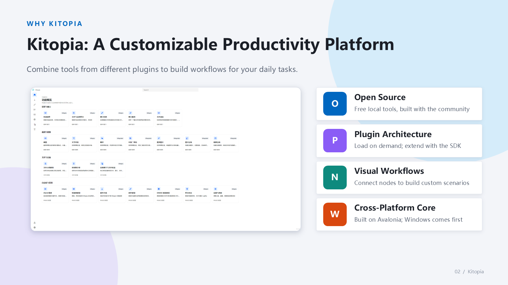
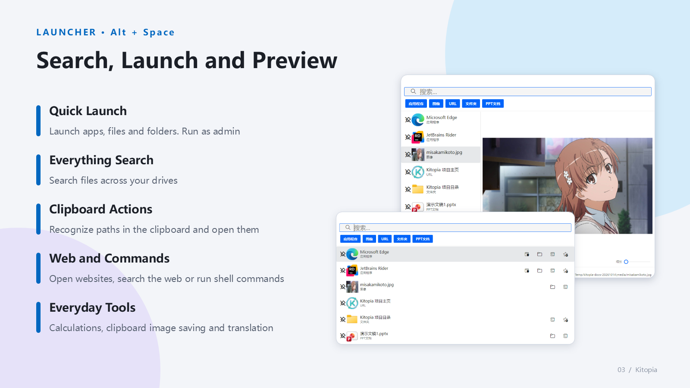
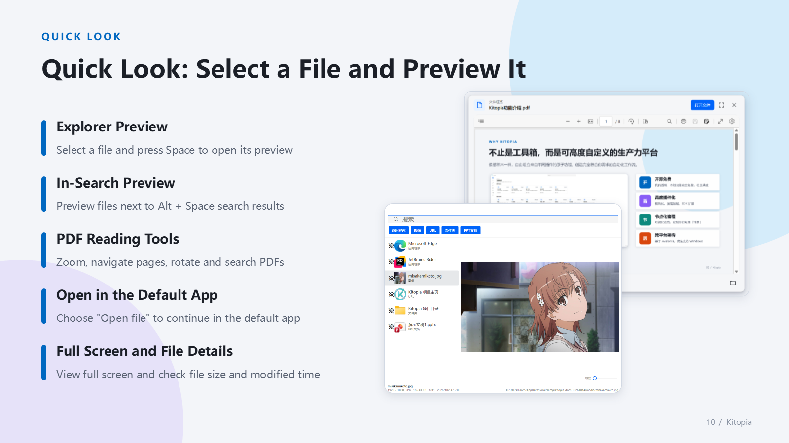
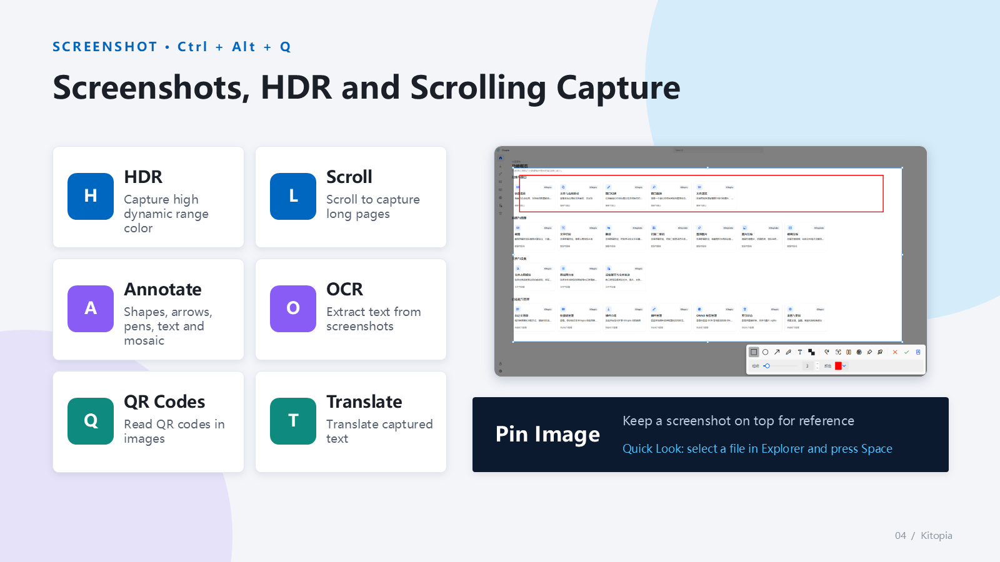
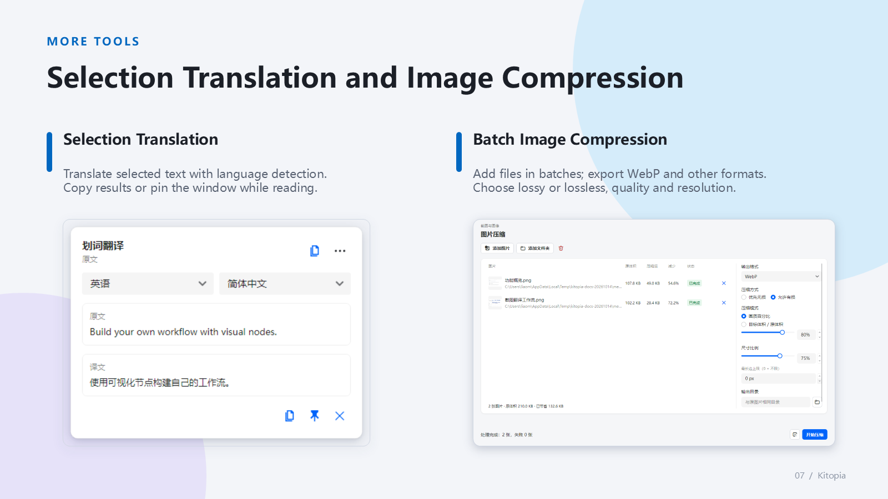
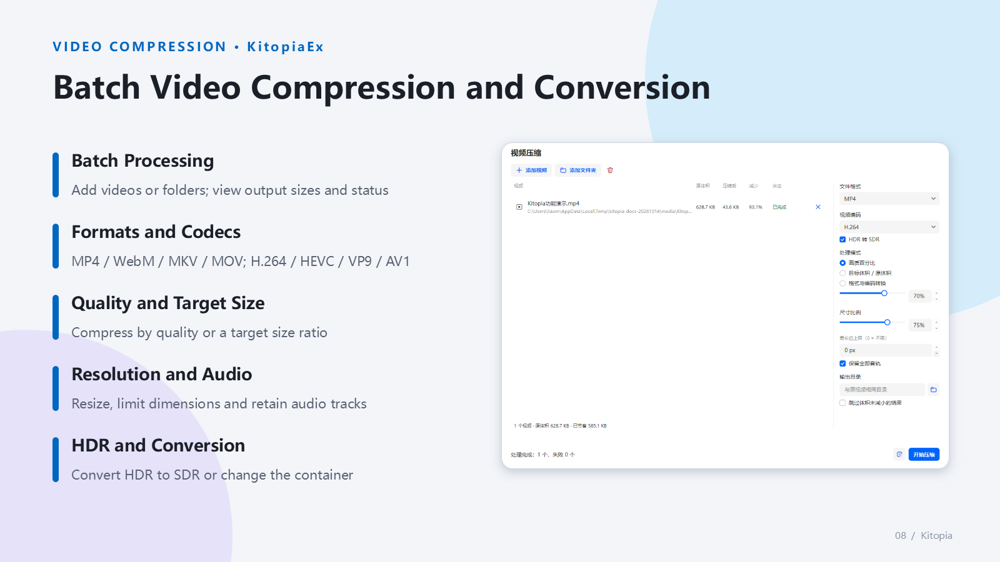
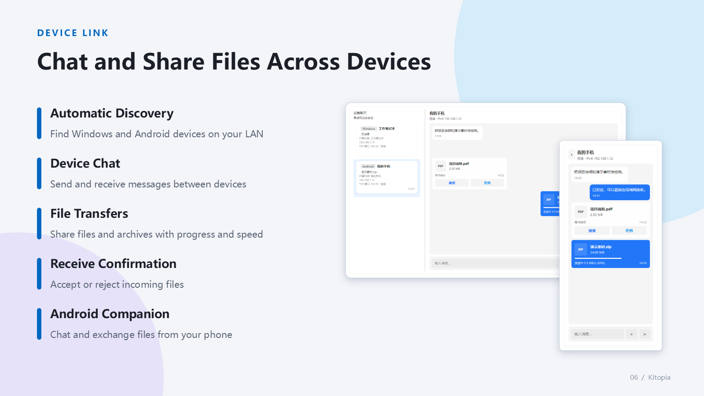
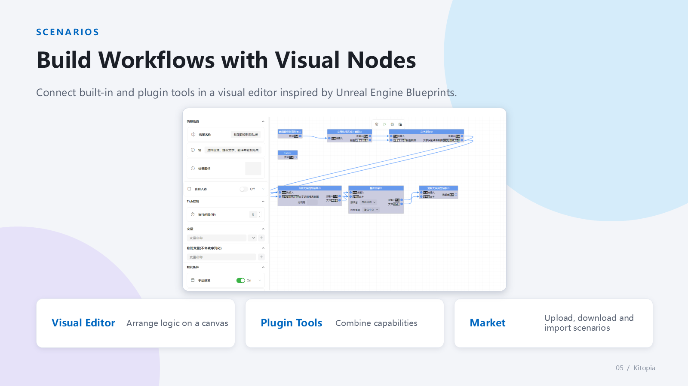
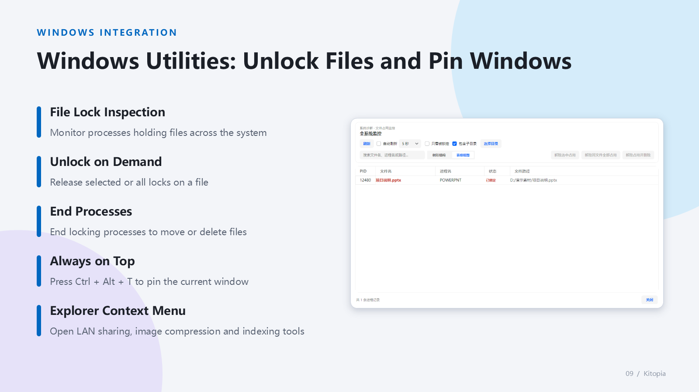
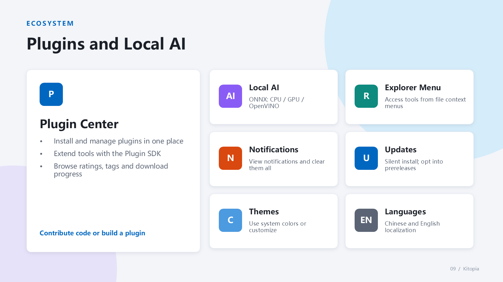

# Kitopia - Your Next-Gen All-in-One Desktop Productivity Suite

[](https://deepwiki.com/Maklith/Kitopia)
> [中文](/)

[](https://github.com/Maklith/Kitopia)
[](https://github.com/Maklith/Kitopia/releases)


> **Open Source · Modern · Extensible · Node-based**  
> Desktop tools for search and launch, local AI semantic search, file previews, screenshots and OCR, device sharing, media compression, and visual workflows.

---

## ✨ Overview



---

## ⌨️ Essential Shortcuts (Ready Out of the Box)

Hit the ground running with these intuitive default shortcuts:

| Action | Default Shortcut / Trigger | Usage Scenario |
| :--- | :--- | :--- |
| **Show / Hide Search Launcher** | `Alt + Space` | Launch apps, search files, calculate math, and trigger tools anytime |
| **Screen Capture & Snip** | `Ctrl + Alt + Q` | Region/window snip, long screenshot, annotation, and offline text extraction |
| **Quick Look File Preview** | Select file and press `Space` | Instantly peek into PDFs, images, code, Markdown, and ZIP archives |
| **Selection Translation** | `Ctrl + Alt + Y` or mouse drag-release | Effortlessly translate selected text while reading foreign articles or docs |
| **Pin Window on Top** | `Ctrl + Alt + T` | Keep reference windows floating on top while working or taking notes |

> 💡 *All shortcuts are fully customizable in Settings, supporting keyboard shortcuts, mouse buttons (e.g. side buttons), and per-application scopes.*

---

## 🎯 Feature Walkthrough

### 1. All-in-One Search & Launcher



Open search with `Alt + Space` to launch apps, open files and folders, recognize clipboard paths, visit websites, and run shell commands. Switch between list and split preview modes, with Pinyin matching, history, favorites, and pins. Everything provides full-disk file search. Local AI can find files by document content or image descriptions and requires configured models and an inference backend.

Image source: [Misaka Mikoto, A Certain Scientific Railgun T official character page](https://toaru-project.com/railgun_t/chara/mikoto.html).

---

### 2. Spacebar File Preview (Quick Look)



Select a file in Windows Explorer and press `Space`, or switch to preview mode in search. PDFs support zoom, page navigation, rotation, and text search. View files full screen, check their size and modification time, or choose "Open file" to continue in the default application. Images, text, code, and archives are also supported. PDF previews require WebView2 Runtime.

---

### 3. Ultimate Snipping, Annotation & Offline OCR



Start capture with `Ctrl + Alt + Q`, with HDR, scrolling capture, annotations, and color picking. OCR uses local models. QR decoding, screenshot pinning, and screenshot translation come from `KitopiaEx`; translation requires network services.

---

### 4. Selection Translation & Batch Media Compression



Select text and press `Ctrl + Alt + Y`, or enable automatic translation on mouse release. `KitopiaEx` batch-compresses JPG, PNG, and WebP by quality or target size, with image resizing.



Video supports MP4, WebM, MKV, and MOV with H.264, HEVC, VP9, and AV1; codec choices depend on the format. Configure target size, resolution, maximum dimension, audio retention, and HDR-to-SDR conversion, or change the container while keeping the original codec.

---

### 5. Cross-Device LAN Sharing (Kitopia Mobile)



Windows and Android devices discover each other on the LAN and exchange messages and files without account login. Transfers use TCP/TLS, with receive confirmation, progress, and speed indicators.

---

### 6. Node-Based Visual Automation (Scenarios)



Connect screenshot, OCR, translation, clipboard, and other nodes to build workflows. Run scenarios from search, hotkeys, or configured triggers, and download shared scenarios from the market.

---

### 7. Deep Windows System Utilities



Inspect processes holding a file, then unlock it or end a process as needed. `Ctrl + Alt + T` toggles a window's topmost state. Explorer context menus provide access to LAN sharing, image compression, and indexing.

---

### 8. Plugin Center & Hardware Acceleration



Install, enable, and manage extensions in the plugin center. OCR and semantic search use local ONNX models with CPU, Windows GPU, or Intel OpenVINO backends. Device support depends on the plugin and runtime environment.

---

## 📥 Download & Installation

Please visit the [GitHub Releases Page](https://github.com/Maklith/Kitopia/releases) to download the latest version:

| Platform / Edition | Package Type | Description |
| :--- | :--- | :--- |
| **Windows Desktop (Recommended)** | `win-x64` / `win-arm64` Installer (.exe) | Recommended for general users. One-click setup with automatic shortcuts and Explorer integration |
| **Windows Portable** | `win-x64` / `win-arm64` Portable (.zip) | Extract and run. Configuration stays with the folder, ideal for USB drives |
| **Android Mobile** | `android-arm64` / `android-x64` APK | Mobile LAN file sharing companion (Android 6.0+), connects with PC over Wi-Fi |
| **Linux / iOS** | In Development | Linux desktop support is evolving; iOS mobile host project is in progress |

> 📌 **Helpful Tips**:
> 1. **Full-Disk File Search**: We recommend running Everything alongside Kitopia (can be set to auto-start with Kitopia in Settings) for millisecond disk search.
> 2. **Advanced Extensions**: QR code recognition, screenshot translation, pinning, and batch image/video compression are provided by the official `KitopiaEx` plugin, which can be confirmed in "Installed Plugins".
> 3. **Local AI & OCR**: Upon first launch, the local semantic search and offline OCR models will be prepared automatically without needing Python or manual setup.

---

## 🔒 Privacy & Data Security

In an age where data privacy is paramount, Kitopia adheres strictly to a **Local-First** design:

- 🛡️ **100% Local Storage**: Your file indices, search history, OCR text, and AI embeddings are stored entirely on your local machine (under `%LOCALAPPDATA%\Kitopia`), never uploaded to external servers.
- 🛡️ **Encrypted Direct Transfer**: Cross-device sharing uses peer-to-peer TLS encrypted communication within your LAN. No cloud account is required, and transfers work even without an internet connection.
- 🛡️ **Open Source & Clean**: Completely open-source codebase with zero ads, zero bloatware, and zero background tracking.

---

## ❓ Frequently Asked Questions (FAQ)

<details>
<summary><b>Q1: Why can't I find certain files with full-disk search?</b></summary>

Kitopia's full-disk file search integrates deeply with Everything. Please ensure Everything is installed and running. Prefixing your query with `@` (e.g. `@report`) triggers Everything search directly. You can also configure Kitopia to search all files without typing `@` in Settings -> "File Indexing".
</details>

<details>
<summary><b>Q2: Does local AI semantic search and OCR consume lots of CPU or GPU?</b></summary>

No. The built-in AI models are heavily quantized and lightweight, consuming virtually 0% resources when idle. They only compute during active indexing or when OCR is explicitly triggered. You can also cap CPU usage or switch to GPU/OpenVINO acceleration in Settings without affecting your gaming or work.
</details>

<details>
<summary><b>Q3: Why can't my phone and PC find each other?</b></summary>

1. Make sure both devices are connected to the **exact same Wi-Fi network** (not guest Wi-Fi or isolated subnets).
2. Check if your router has "AP Isolation / Client Isolation" turned on; disable it if enabled.
3. Verify that Windows Firewall allows Kitopia to communicate over private/local networks.
</details>

<details>
<summary><b>Q4: What if a shortcut conflicts with my game or other software?</b></summary>

Click the keyboard icon on the left navigation bar to open "Hotkeys Management". You can double-click any action to customize its shortcut, map it to mouse buttons, or set exclusion rules for specific games or applications.
</details>

---

## 🤝 Open Source & Community

Kitopia is an open-source project licensed under **GPL-3.0**. If you enjoy Kitopia, please consider giving it a ⭐️ Star on GitHub to support development!

- 🌐 [Project Homepage (GitHub)](https://github.com/Maklith/Kitopia)
- 🐛 [Issues & Feedback](https://github.com/Maklith/Kitopia/issues)
- 🔌 [Plugin SDK (PluginCore)](https://github.com/Maklith/PluginCore)
- 📜 [License (GPL-3.0)](https://github.com/Maklith/Kitopia/blob/HEAD/LICENSE)

<details>
<summary><b>💻 Developer & Build Instructions (Click to expand)</b></summary>

Kitopia is built with **.NET 10 / C#**, **Avalonia UI**, and **Rust** (installer):

```powershell
# Clone repo with submodules
git clone --recurse-submodules https://github.com/Maklith/Kitopia.git
cd Kitopia

# Build desktop project
dotnet restore "Kitopia.Desktop/Kitopia.Desktop.csproj"
dotnet build "Kitopia.Desktop/Kitopia.Desktop.csproj" -c Debug

# Run tests
dotnet test "KitopiaTest/KitopiaTest.csproj"
```

For architecture boundaries and guidelines, please refer to `AGENTS.md` in the repository root.
</details>
